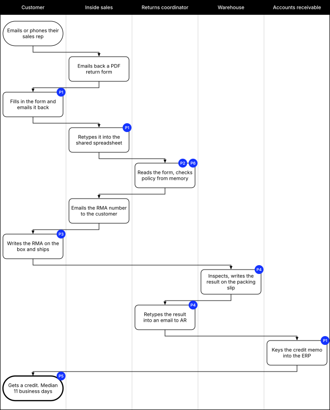
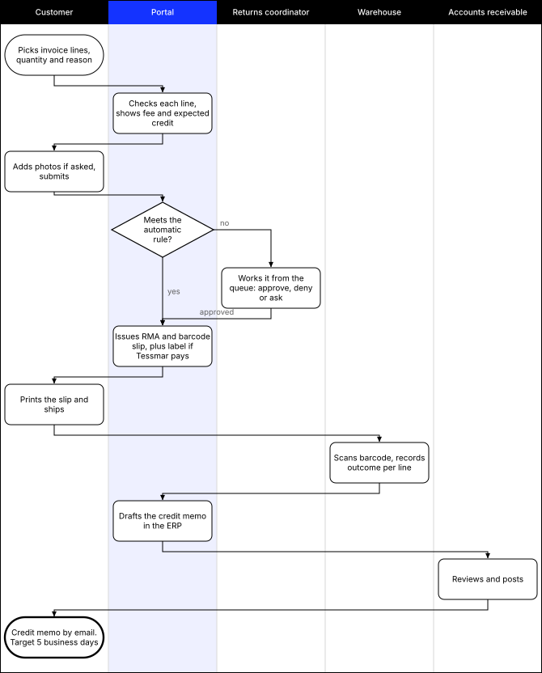

# Requirements for a B2B returns portal

A business requirements document for a self-service returns portal at an industrial parts distributor.

**[Read the document (PDF, 26 pages)](Returns-Portal-Requirements.pdf)**

## The case

Tessmar Industrial Supply is a company I made up: a regional distributor of bearings, belts, hydraulic hose and fasteners with about 1,850 business customers. It handles around 310 returns a month by email, phone and a shared spreadsheet. A return takes a median of 11 business days to become a credit, one package in five turns up with nothing to say whose it is, and nearly one credit in five has to be corrected afterwards.

The company, the people and every number are invented. I wanted a realistic problem to write requirements for, with enough mess in it to be worth the exercise: five teams, a policy applied from memory, and an ERP that has to stay the system of record.

## What is in the document

| Section | What it covers |
| --- | --- |
| Goals | Five goals, each with a baseline, a target and how it will be measured |
| Stakeholders | Eleven stakeholders with interest, influence and what each needs, plus who does what on the project |
| Current process | A swimlane diagram of how a return works today and the six problems in it |
| Future process | The same return through the portal, and the statuses it moves through |
| Business rules | The return policy written as 11 rules a system can apply |
| User stories | 12 stories with 42 acceptance criteria, each written to pass or fail |
| Requirements | 33 functional and 10 non-functional requirements, prioritized |
| Data and integrations | What the portal stores and what it exchanges with the ERP, the carrier and email |
| Acceptance testing | Who tests, entry and exit conditions, and 24 scenarios |
| Traceability | Every story tied to its goals, requirements and tests |
| Open questions | 11 things the business still has to decide |

## The two process diagrams

How a return works today. The blue markers are the problems.

How it will work. The shaded lane is the portal.

## The spreadsheets

The tables in the PDF are also here as CSV files, so they can be opened in Excel or loaded into a tool like Jira.

- `requirements.csv`: the 33 functional requirements with priority, goals and stories
- `user-stories.csv`: one row per acceptance criterion, with the requirements and tests for each story
- `uat-scenarios.csv`: the 24 test scenarios, with blank columns for result, tester and date
- `business-rules.csv`: the 11 rules
- `open-questions.csv`: the 11 open questions, with blank columns for the answer

## Three things I would point to

**Acceptance criteria that can fail.** "The portal validates the quantity" cannot be tested. "Given an invoice line for 10 units with 4 already returned, when I enter 7, then the portal rejects it and tells me 6 can still be returned" can.

**Nothing is there without a reason.** Every requirement traces to a goal and every story traces to a test. Section 15 is the table that shows it.

**The open questions.** This was the hardest section to write. Each one is a real decision that changes the design, such as whether the restocking fee applies to customers whose contracts say returns are free. A requirements document that claims to have no open questions usually just has not found them yet.

## What is missing

This is a first version for review, not a signed-off specification. It has no screen designs, no cost estimate and no project schedule. It also has not been through the thing that improves requirements the most: the people who do the work reading it and saying what is wrong.
